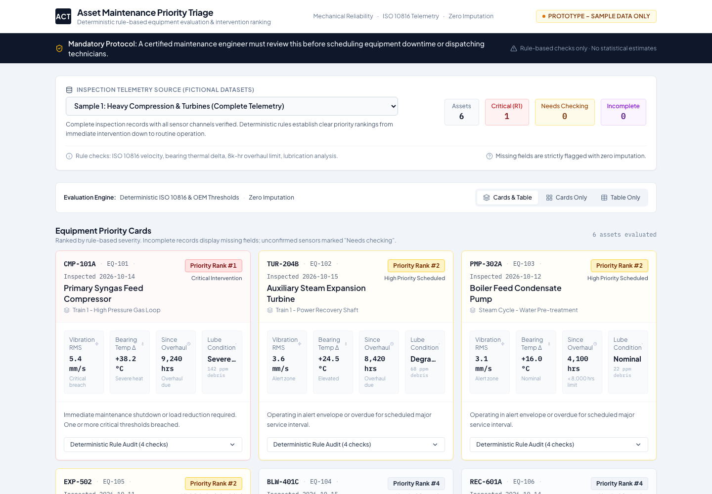
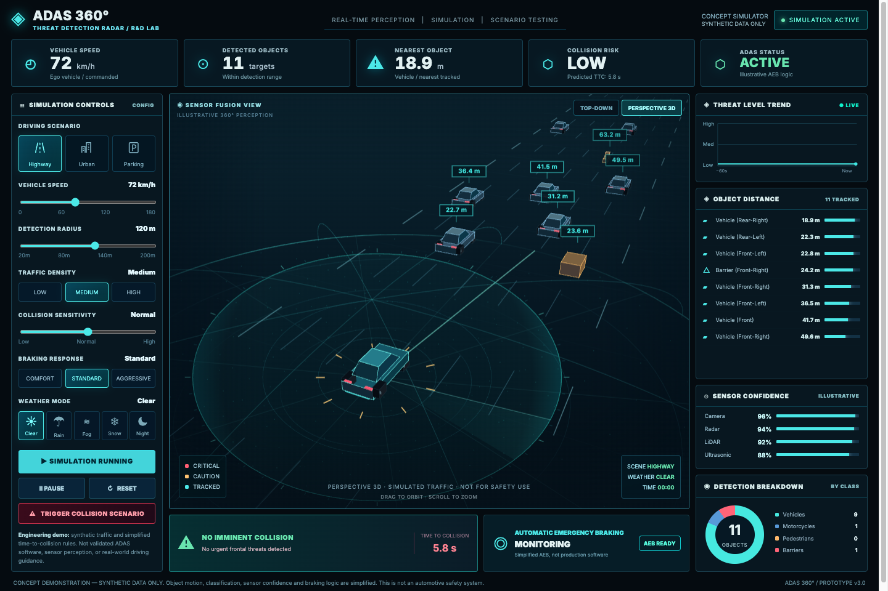

# awantec

Training apps for manufacturing engineers, plus a hub page that links to every deployed one.

Hub: https://awantec-hub-271836949821.asia-southeast1.run.app (short links: `/cheatsheet`, `/twin`, `/paint`, `/triage`, `/torque`, `/adas`)

The apps run in the browser and use synthetic data only. Most deploy to Google Cloud Run as static sites behind Nginx; the triage console runs on Google AI Studio.

| App | Folder | What it does | Stack |
|---|---|---|---|
| [FORGE / Smart Factory Digital Twin](apps/smart-factory-twin-3d/) | `apps/smart-factory-twin-3d` | Simulates a nine-station car assembly line in 3D so you can find the bottleneck and test fixes | React, Vite, three.js, Recharts |
| [Torque Signature Analyser](apps/torque-signature-analyser/) | `apps/torque-signature-analyser` | Flags bolt-tightening rundowns that look unusual against a known-good reference and replays one in 3D | React, Vite, three.js, FastAPI, scikit-learn |
| [ADAS 360° Threat Detection Simulator](apps/adas-360-simulator/) | `apps/adas-360-simulator` | Runs simulated traffic around a car so you can see when emergency braking avoids a collision | One HTML file, canvas |
| [Asset Maintenance Priority Triage](apps/asset-maintenance-priority-triage/) | `apps/asset-maintenance-priority-triage` | Ranks fictional equipment by maintenance priority with fixed rule checks. Built from the cheatsheet prompt | React, Vite, Tailwind |
| [Hub](hub/) | `hub` | Lists the deployed apps and redirects short links like `/twin`. Add an app in `hub/apps.json` | One HTML file + JSON |
| [AI Ideation Cheatsheet](training-cheatsheet/) | `training-cheatsheet` | Walks you through writing a build prompt for an AI tool, with a worked example | One HTML file |

## FORGE / Smart Factory Digital Twin

You change a station's cycle time, buffer, failure rate or staffing. A discrete-event simulation reruns the line and shows output, WIP, lead time and which station limits throughput. An advisor ranks candidate improvements by capacity gain.


```bash
cd apps/smart-factory-twin-3d
npm install
npm run dev
```

Details: [`apps/smart-factory-twin-3d/README.md`](apps/smart-factory-twin-3d/README.md)

## Asset Maintenance Priority Triage

You pick one of three fictional inspection datasets from a dropdown. The app checks vibration, bearing temperature, overhaul hours and lubricant condition for each machine, ranks them 1 to 4, and flags incomplete or uncertain records instead of guessing. It is the kind of app the cheatsheet prompt asks an AI tool to build.

Live: https://air-compressor-argon.ai.studio/



```bash
cd apps/asset-maintenance-priority-triage
npm install
npm run dev
```

Details: [`apps/asset-maintenance-priority-triage/README.md`](apps/asset-maintenance-priority-triage/README.md)

## Torque Signature Analyser

You pick one of ten synthetic bolt-tightening packs across five joints (wheel hub, brake caliper bracket, subframe, seat-belt anchor, engine mount). The app finds the snug point on each torque-angle curve, compares it with a known-good reference group and your spec limits, and ranks the rundowns worth a second look. A 3D flange turns the selected bolt as the cursor plays along its curve.

Live: https://torque-signature-analyser-271836949821.asia-southeast1.run.app


```bash
cd apps/torque-signature-analyser
python3 -m venv api/.venv
api/.venv/bin/pip install -r api/requirements.txt
api/.venv/bin/uvicorn api.main:app --port 8080   # API
cd web && npm install && npm run dev               # web on :5173
```

Details: [`apps/torque-signature-analyser/README.md`](apps/torque-signature-analyser/README.md)

## ADAS 360° Threat Detection Simulator

You pick a scenario (highway, urban, parking) and set speed, detection radius, traffic density, collision sensitivity, braking response and weather. Traffic moves around the car in 3D; the panels show nearest objects, time to collision and when automatic emergency braking engages. **Trigger collision scenario** drops an obstacle in your lane to test the braking settings.

Live: https://adas-360-simulator-271836949821.asia-southeast1.run.app



```bash
open apps/adas-360-simulator/index.html
```

Details: [`apps/adas-360-simulator/README.md`](apps/adas-360-simulator/README.md)

## AI Ideation Cheatsheet

You fill in a notepad (user, goal, input, sample cases, output, reviewer) and copy the prompt it builds. The page also gives a sample prompt, three user stories and four fix prompts for when the first build misses. The example app is an air compressor health monitor.


```bash
open training-cheatsheet/index.html
```

Details: [`training-cheatsheet/README.md`](training-cheatsheet/README.md)

## Repository layout

```
apps/
  adas-360-simulator/      single-page ADAS radar simulator
  asset-maintenance-priority-triage/  React rule-based triage console (AI Studio)
  smart-factory-twin-3d/   React + three.js digital twin
  torque-signature-analyser/  React + FastAPI bolt-tightening curve analyser
hub/                       index page and short-link redirects
training-cheatsheet/       single-page prompt worksheet
```

Each Cloud Run app has its own Dockerfile and deploys on its own with `gcloud run deploy --source .` from its folder. Full steps: [`DEPLOY.md`](DEPLOY.md).

## Design references

- [nutlope/hallmark](https://github.com/nutlope/hallmark): page structure and removing generic generated-UI patterns
- [cathrynlavery/diagram-design](https://github.com/cathrynlavery/diagram-design): axonometric plant layout and process-flow diagram
- [hardikpandya/stop-slop](https://github.com/hardikpandya/stop-slop): plain, specific copy in the UI and these docs
