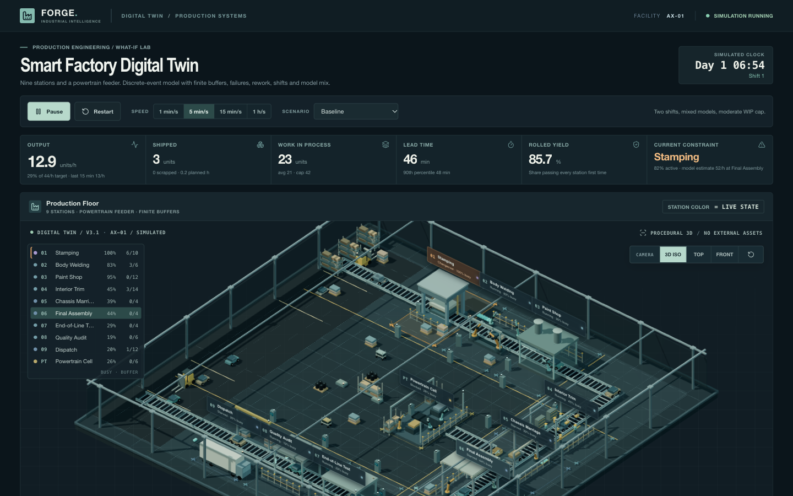

# awantec

Training apps for manufacturing engineers, plus a hub page that links to every deployed one.

Hub: https://awantec-hub-271836949821.asia-southeast1.run.app (short links: `/cheatsheet`, `/twin`, `/paint`)

The apps run in the browser, use synthetic data only, and deploy to Google Cloud Run as static sites behind Nginx.

| App | Folder | What it does | Stack |
|---|---|---|---|
| [FORGE / Smart Factory Digital Twin](apps/smart-factory-twin-3d/) | `apps/smart-factory-twin-3d` | Simulates a nine-station car assembly line in 3D so you can find the bottleneck and test fixes | React, Vite, three.js, Recharts |
| [Hub](hub/) | `hub` | Lists the deployed apps and redirects short links like `/twin`. Add an app in `hub/apps.json` | One HTML file + JSON |
| [AI Ideation Cheatsheet](training-cheatsheet/) | `training-cheatsheet` | Walks you through writing a build prompt for an AI tool, with a worked example | One HTML file |

## FORGE / Smart Factory Digital Twin

You change a station's cycle time, buffer, failure rate or staffing. A discrete-event simulation reruns the line and shows output, WIP, lead time and which station limits throughput. An advisor ranks candidate improvements by capacity gain.



```bash
cd apps/smart-factory-twin-3d
npm install
npm run dev
```

Details: [`apps/smart-factory-twin-3d/README.md`](apps/smart-factory-twin-3d/README.md)

## AI Ideation Cheatsheet

You fill in a notepad (user, goal, input, sample cases, output, reviewer) and copy the prompt it builds. The page also gives a sample prompt, three user stories and four fix prompts for when the first build misses. The example app is an air compressor health monitor.


```bash
open training-cheatsheet/index.html
```

Details: [`training-cheatsheet/README.md`](training-cheatsheet/README.md)

## Repository layout

```
apps/
  smart-factory-twin-3d/   React + three.js digital twin
hub/                       index page and short-link redirects
training-cheatsheet/       single-page prompt worksheet
```

Each app has its own Dockerfile and deploys on its own with `gcloud run deploy --source .` from its folder.

## Design references

- [nutlope/hallmark](https://github.com/nutlope/hallmark): page structure and removing generic generated-UI patterns
- [cathrynlavery/diagram-design](https://github.com/cathrynlavery/diagram-design): axonometric plant layout and process-flow diagram
- [hardikpandya/stop-slop](https://github.com/hardikpandya/stop-slop): plain, specific copy in the UI and these docs
