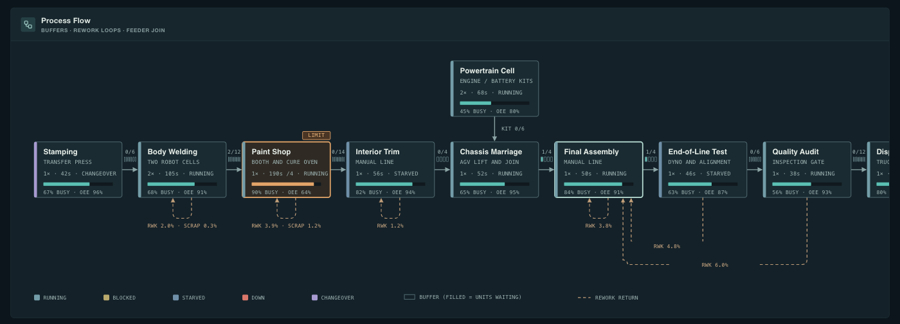
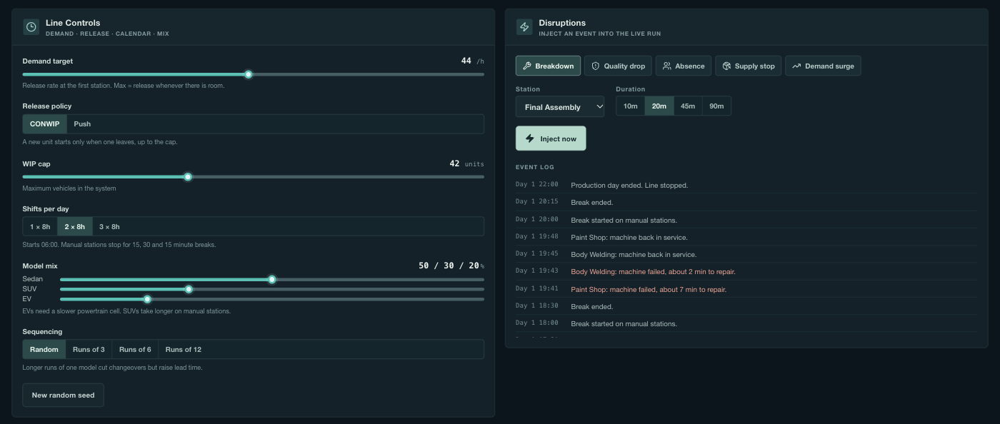
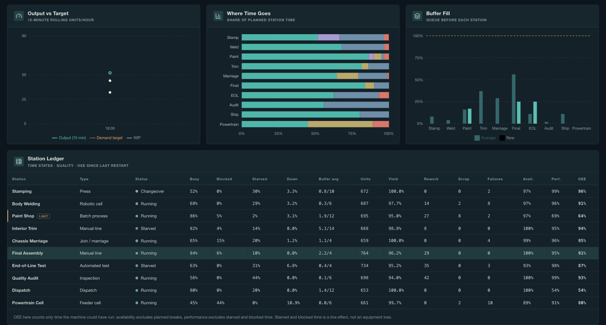
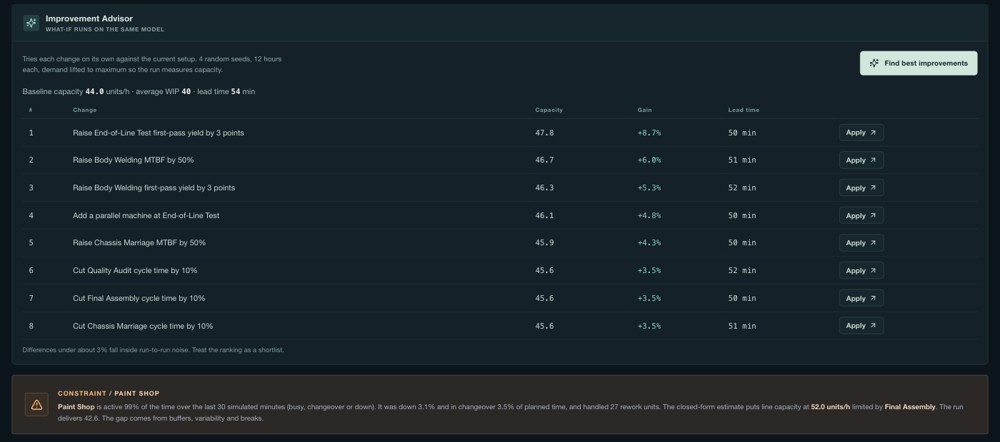
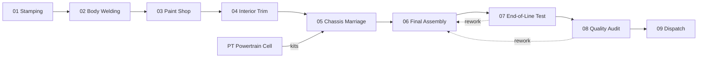

# FORGE / Smart Factory Digital Twin

A browser-based digital twin of a car assembly plant. You change a station's cycle time, buffer, failure rate or staffing, and the line simulation shows where throughput drops and which station limits the plant.

All data is synthetic. The app has no backend, no PLC connection and no external AI calls.


## Quick start

```bash
npm install
npm run dev
```

You need Node.js 20+ and a browser with WebGL. Open the URL Vite prints.

```bash
npm test        # Node built-in test runner, covers the simulation engine
npm run build   # static bundle in dist/
npm run preview
```

## What you see

| Panel | What it tells you |
|---|---|
| KPI strip | Output per hour against target, units shipped, WIP, lead time, rolled yield, current constraint |
| Production floor | Procedural 3D plant laid out as a U-shaped loop. Station colors follow live state. Floor blocks show each input buffer |
| Process flow | Stations as boxes with busy share, OEE, buffer fill and rework return paths. The constraint carries a `LIMIT` tag |
| Station controls | Sliders for the selected station |
| Line controls and disruptions | Demand, release policy, shifts, model mix, sequencing, and buttons that inject a breakdown, quality drop, absence, supply stop or demand surge |
| Charts and ledger | Output trend, where each station's time goes, buffer fill, and a per-station table with OEE |
| Improvement advisor | Runs each candidate change on the same engine and ranks them by capacity gain |









## The line



Nine stations and one feeder. Each station has a finite input buffer, so a slow station starves the ones after it and blocks the ones before it.

## The model

`src/sim/engine.js` runs a seeded discrete-event simulation that advances one simulated second per tick. The same config and seed give the same run.

Per station you can set: cycle time and variability, parallel machines, buffer size, MTBF and MTTR, first-pass yield, scrap share, rework target, changeover time, line speed, staffing and batch size.

Per line you can set: demand target, CONWIP or push release, WIP cap, 1 to 3 shifts with breaks, model mix (sedan, SUV, EV) and run-length sequencing.

The scenario menu loads presets: baseline, unreliable press, paint defects, demand surge, staff shortage, EV-heavy mix, lean WIP and single shift.

The advisor tests each change on 4 seeds over 12 simulated hours. Gains under about 3% sit inside run-to-run noise, so read the list as a shortlist.

`src/sim/analysis.js` also computes a closed-form capacity estimate. It ignores starving, blocking and variability, so it reads higher than the simulation. The gap between the two numbers is what those effects cost you.

**Limits:** one product flow, no maintenance planning, no operator skill model, no part-level material tracking, and a simplified break calendar.

## Project layout

```
src/
  App.jsx               page layout and simulation loop
  FactoryScene.jsx      procedural 3D plant (react-three-fiber)
  components/           panels: flow diagram, controls, charts, ledger, advisor
  sim/engine.js         discrete-event simulation
  sim/analysis.js       closed-form capacity estimate, constraint detection
  sim/config.js         station types, default line, scenarios
tests/engine.test.js    engine tests
```

Stack: React 18, Vite 6, three.js with react-three-fiber and drei, Recharts, lucide-react.

## Deploy to Cloud Run

```bash
gcloud run deploy smart-factory-twin \
  --source . \
  --region asia-southeast1 \
  --allow-unauthenticated
```

The multi-stage Dockerfile builds with Node 22 and serves `dist/` from Nginx on port 8080. You need gcloud auth, a selected project, and the Cloud Run and Cloud Build APIs enabled. The app needs no secrets.

See [`DESIGN.md`](DESIGN.md) for the visual system.
