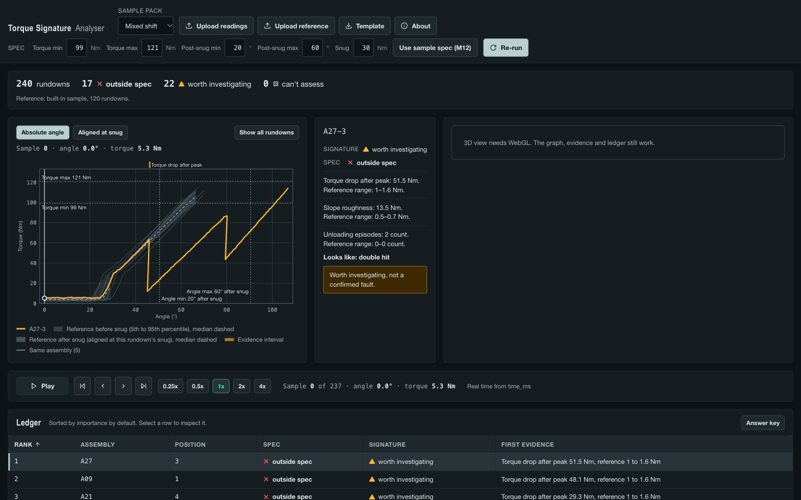
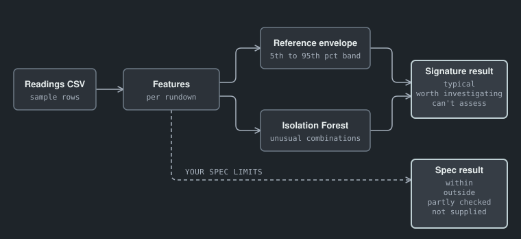

# Torque Signature Analyser

A browser tool for reviewing bolt tightening curves. You load a CSV of torque-angle rundowns, and the app compares each one with a reference group, checks it against your spec limits, and flags the ones worth a second look. A 3D flange shows the selected bolt turning as you scrub the cursor along its curve.

All data is synthetic. The app ships ten sample packs across five joints (wheel hub, brake caliper bracket, subframe, seat-belt anchor, engine mount) and has no database, no login and no external AI calls. Every spec in the packs is illustrative, not an OEM value.

## Demo mode

The header carries a "Synthetic demo data" badge. The upload, reference and template controls are hidden. Add `?upload=1` to the URL to show them; the API endpoints stay on either way.

On load and on every selection the cursor plays the rundown and loops, holding the last pose for one second. **Loop** turns that off. **Tour** (off by default) moves to the next flagged rundown after each loop, by rank, and wraps. Any click, drag, key press or pause turns Tour off. With `prefers-reduced-motion`, nothing starts by itself and Tour is disabled; Play and Loop still work. Playback starts at 0.25x because a real rundown lasts under a second.

## Sample packs

`api/synth.py` holds a joint profile per joint (snug torque, target torque, slope, bolts per assembly, sample spacing). The wheel-hub patterns are written once; the other joints map those curves through their profile. Each pack ships its own spec and a 120-rundown reference. Regenerate with `api/.venv/bin/python -m api.synth` (seed 7). Held-out seeds 101, 202 and 303 are used only by the tests.



## Run locally

You need Python 3.13 and Node.js 20+.

```bash
# API on :8080
python3 -m venv api/.venv
api/.venv/bin/pip install -r api/requirements.txt -r api/requirements-dev.txt
api/.venv/bin/uvicorn api.main:app --port 8080 --reload

# Web on :5173, proxies /api to :8080
cd web
npm install
npm run dev
```

Tests:

```bash
api/.venv/bin/pytest api/tests -q    # from the app folder
cd web && npm test
```

To serve the built app from the API alone, run `npm run build` in `web/`. The API then serves `web/dist` at `/`.

## CSV schema

One row per sample. A header row is required. Column names are not case-sensitive, and `,` or `;` both work as the separator. `GET /api/template.csv` returns a template.

| Column | Required | Meaning |
|---|---|---|
| `rundown_id` | yes | Identifies one tightening. Rows with the same ID form one curve |
| `angle_deg` | yes | Turn angle in degrees, from -10 to 3600 |
| `torque_nm` | yes | Torque in newton metres |
| `sample_index` | no | Sample order within the rundown. Rows keep file order if you leave it out |
| `time_ms` | no | Time since the start of the rundown |
| `assembly_id` | no | Groups bolts into one assembly. Defaults to `rundown_id` |
| `bolt_position` | no | Bolt number within the assembly |
| `seeded_pattern` | no | Answer key in the sample files. The app ignores it for scoring and returns it unchanged |

Limits: 5 MB per file, 64 columns, 500 rundowns, 5000 points per rundown. The server runs two analyses at a time and answers 503 "Server busy" to a request that waits more than 10 seconds. Bad rows come back with the row, the column and a suggested fix.

You can upload a second file as the reference group. Without one, the app compares each rundown with the whole upload, itself included.

## How it works



The API finds the snug point on each curve, extracts features (post-snug slope, final torque, angle past snug, shape deviation from the reference median) and scores them with z-scores and an isolation forest. A rundown outside your torque or angle limits is marked outside spec. A rundown inside the limits but unlike the reference is marked for investigation.

## Limits

- The data is synthetic. Real traces from your tool will differ.
- Checked on 3 held-out synthetic seeds with 3-5 in-spec abnormal rundowns each. That is too few to quote a detection rate.
- A flag means "worth checking". It is not a confirmed fault.
- "Typical" means statistically similar to the reference. It does not approve quality.
- An uploaded reference is assumed good. A shift that moves the whole batch can disappear into the reference.
- The tool handles continuous-drive traces only.

## Independent reviews

Codex reviewed the code at three checkpoints. The full text is in `docs/codex-reviews/`.

- [Checkpoint 1](docs/codex-reviews/2026-10-17-checkpoint-1.md): 1 Critical and 7 Important findings on the analysis and upload path. All actioned.
- [Checkpoint 2](docs/codex-reviews/2026-10-17-checkpoint-2.md): 4 Important findings on the 3D scene, covering the WebGL fallback, camera fitting and accessibility.
- [Checkpoint 3](docs/codex-reviews/2026-10-17-checkpoint-3.md): 13 of 19 earlier findings fixed, 4 partly fixed, 2 deferred as stated.

## Deploy

From this folder, to Cloud Run in project `marii-ge`:

```bash
gcloud run deploy torque-signature-analyser --source . --region asia-southeast1 --project marii-ge --allow-unauthenticated --memory 1Gi --cpu 1 --concurrency 4 --min-instances 0
```

The Dockerfile in this folder builds the web bundle in a Node stage, then runs the API on Python 3.13 as a non-root user and serves the bundle on `$PORT` (8080). It installs `api/requirements.txt` only; `api/requirements-dev.txt` adds the test packages. Register the resulting URL in `hub/apps.json`, as described in the repo root DEPLOY.md.

Measured in a container limited to 1 GB and 1 CPU: four concurrent uploads of a 4.9 MB, 500-rundown file peaked at 387 MiB, and the first `/healthz` answered 0.84 s after `docker run`.

Local check:

```bash
docker build -t torque . && docker run -p 8080:8080 torque
curl localhost:8080/healthz
```
