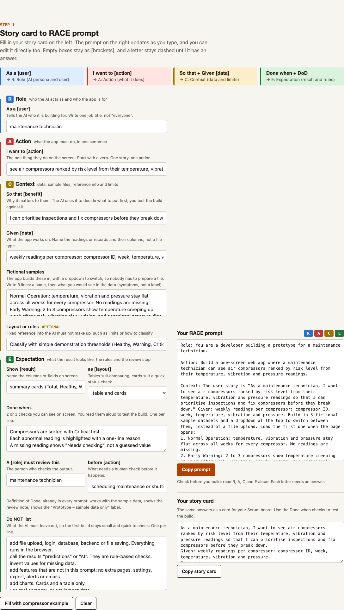
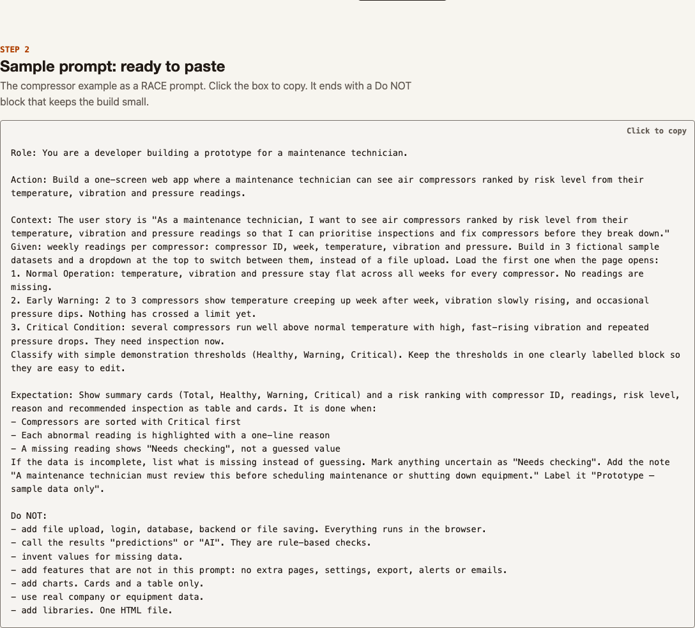
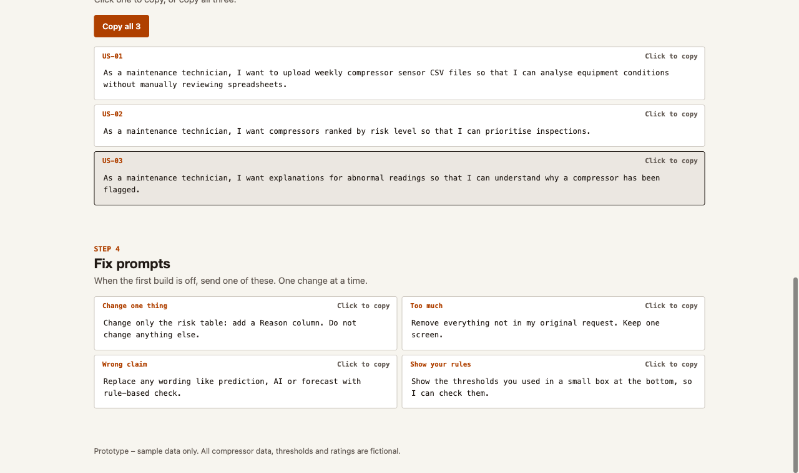

# AI Ideation Cheatsheet

A one-page worksheet for a training session. You write one user story card, the page turns it into a RACE build prompt (Role, Action, Context, Expectation), and you paste it into your AI tool. It follows slides 43–48 of the *AI Ideation & Prototyping* deck. The worked example is an air compressor health monitor for plant maintenance technicians.

The page is one self-contained `index.html`: no build step, no backend, no external scripts or fonts.



## Run it

Open `index.html` in a browser. To serve it:

```bash
python3 -m http.server 8080
```

## The four sections

1. **Story card to RACE prompt.** The fields are grouped by letter: As a → Role, I want to → Action, So that + Given + samples → Context, Done when + review step → Expectation. The RACE prompt and the story card on the right update as you type. Empty fields stay as `[brackets]`, and the R A C E badges stay dashed until each letter has an answer ("check before you build").
2. **Sample prompts.** Two finished RACE prompts: the compressor monitor, and a three.js robot arm maintenance viewer that works on the trainer's CSV files. Click to copy.
3. **User stories.** Three story cards (As a / Given / Done when) for the same app. "Turn into prompt" loads a card into step 1; copy one or all three.
4. **Fix prompts.** Five one-change follow-ups (including "what I see vs expected"), plus the slide's Do / Avoid golden rules.





The template and the compressor prompt ask for fictional sample datasets built into the app, with a dropdown to switch between them. Nobody has to prepare or upload a file to test it.

The template and the compressor prompt end with a `Do NOT:` block. It keeps the generated app small: no login, no backend, no charts, no "AI" or "prediction" wording, no invented values for missing data.

## Deploy to Cloud Run

```bash
gcloud config set project marii-ge
gcloud run deploy ai-ideation-cheatsheet --source . --region asia-southeast1 --allow-unauthenticated
```

Run it from this folder. The Dockerfile copies `index.html` into `nginx-unprivileged` on port 8080.

Test the container locally:

```bash
docker build --platform linux/amd64 -t ai-ideation-cheatsheet .
docker run --rm -p 8080:8080 ai-ideation-cheatsheet
```

[`AGENTS.md`](AGENTS.md) holds the edit rules and why the base image is pinned by digest.
